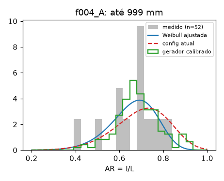

# Modelo de forma: f004_A

Dados: `[{"fonte": "F004", "grupo": "A"}]`

| até (mm) | n | AR escala | AR forma | h | KS AR (novo) | KS AR (config atual) | perda gerador: atual → calibrado |
|---|---|---|---|---|---|---|---|
| 999 | 52 | 0.6821 | 9.149 | 0.771 | 0.161 | 0.244 | 1.681 → 0.568 |

Angulosidade global: 0.999

KS = estatística de Kolmogorov-Smirnov (menor é melhor). A "perda do gerador" soma o KS de AR, h e
preenchimento da caixa entre as formas geradas por md_core._forma e as medidas.

