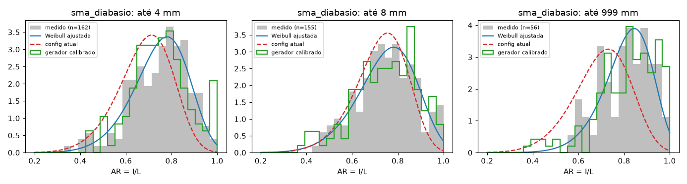

# Modelo de forma: sma_diabasio

Dados: `[{"fonte": "F001", "grupo": "20200429_antes"}]`

| até (mm) | n | AR escala | AR forma | h | KS AR (novo) | KS AR (config atual) | perda gerador: atual → calibrado |
|---|---|---|---|---|---|---|---|
| 4 | 162 | 0.7518 | 6.93 | 0.8 | 0.047 | 0.256 | 1.126 → 0.343 |
| 8 | 155 | 0.7823 | 4.952 | 0.741 | 0.054 | 0.116 | 1.308 → 0.466 |
| 999 | 56 | 0.9162 | 4.552 | 0.74 | 0.071 | 0.390 | 1.629 → 0.429 |

Angulosidade global: 0.988

KS = estatística de Kolmogorov-Smirnov (menor é melhor). A "perda do gerador" soma o KS de AR, h e
preenchimento da caixa entre as formas geradas por md_core._forma e as medidas.

