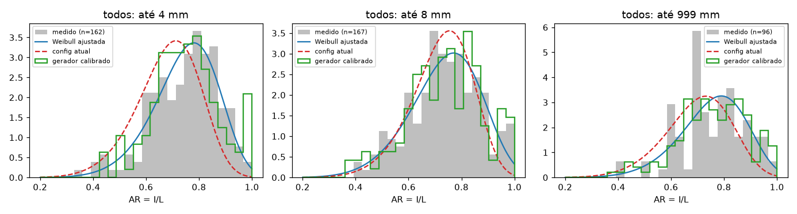

# Modelo de forma: todos

Dados: `[{"fonte": "F001", "grupo": "20200429_antes"}, {"fonte": "F004", "grupo": "A"}]`

| até (mm) | n | AR escala | AR forma | h | KS AR (novo) | KS AR (config atual) | perda gerador: atual → calibrado |
|---|---|---|---|---|---|---|---|
| 4 | 162 | 0.7518 | 6.93 | 0.8 | 0.047 | 0.256 | 1.126 → 0.343 |
| 8 | 167 | 0.7655 | 5.087 | 0.746 | 0.054 | 0.095 | 1.352 → 0.455 |
| 999 | 96 | 0.7853 | 5.801 | 0.748 | 0.078 | 0.209 | 1.430 → 0.453 |

Angulosidade global: 0.986

KS = estatística de Kolmogorov-Smirnov (menor é melhor). A "perda do gerador" soma o KS de AR, h e
preenchimento da caixa entre as formas geradas por md_core._forma e as medidas.

